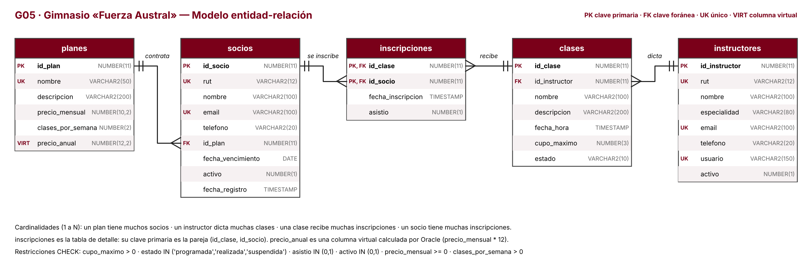

# Diccionario de datos · G05 Gimnasio «Fuerza Austral»

**Asignatura:** Back End  
**Grupo:** G05
**Integrantes:** Manuel Montecions, Claudio Caceres, Giovanni avila
**Motor de base de datos:** Oracle 26ai (FreeSQL)

## 1. Introducción

Este documento describe las tablas de la base de datos del sistema de gestión del gimnasio «Fuerza Austral»: sus columnas, tipos de dato, restricciones y relaciones. El sistema administra planes de membresía, socios, instructores, clases grupales con cupo limitado y las inscripciones de los socios a esas clases.

Las claves primarias se generan con `NUMBER(11) GENERATED BY DEFAULT ON NULL AS IDENTITY (NOCACHE)`. Los textos usan `VARCHAR2`, los valores de dinero `NUMBER(10,2)`, los valores verdadero/falso `NUMBER(1)` con una restricción CHECK, y los estados `VARCHAR2` con una restricción CHECK. Las fechas con hora se almacenan en UTC.

**Notación:** PK = clave primaria · FK = clave foránea · UQ = valor único · CK = restricción CHECK · VIRT = columna virtual calculada por Oracle.

## 2. Modelo entidad-relación

El modelo tiene cinco entidades y cuatro relaciones de uno a muchos:

| Relación | Cardinalidad | Clave foránea |
|---|---|---|
| planes → socios | 1 a N | `socios.id_plan` |
| instructores → clases | 1 a N | `clases.id_instructor` |
| clases → inscripciones | 1 a N | `inscripciones.id_clase` |
| socios → inscripciones | 1 a N | `inscripciones.id_socio` |

La tabla `inscripciones` es la tabla de detalle y no tiene identificador propio: su clave primaria es compuesta por `id_clase` e `id_socio`.

## 3. Tablas

### 3.1 planes

Tipos de membresía que ofrece el gimnasio.

| Columna | Tipo Oracle | Nulo | Restricción | Descripción |
|---|---|---|---|---|
| id_plan | NUMBER(11) IDENTITY | No | PK `pk_planes` | Identificador del plan |
| nombre | VARCHAR2(50) | No | UQ `uq_planes_nombre` | Nombre del plan (por ejemplo, Básico o Premium) |
| descripcion | VARCHAR2(200) | Sí | | Beneficios que incluye el plan |
| precio_mensual | NUMBER(10,2) | No | CK `ck_planes_precio` (>= 0) | Valor mensual del plan en pesos chilenos |
| clases_por_semana | NUMBER(2) | No | CK `ck_planes_clases` (> 0) | Cantidad máxima de clases a las que el socio puede asistir por semana |
| precio_anual | NUMBER(12,2) | Sí | VIRT: `precio_mensual * 12` | Valor anual del plan, calculado por Oracle |

### 3.2 instructores

Personas que dictan las clases del gimnasio.

| Columna | Tipo Oracle | Nulo | Restricción | Descripción |
|---|---|---|---|---|
| id_instructor | NUMBER(11) IDENTITY | No | PK `pk_instructores` | Identificador del instructor |
| rut | VARCHAR2(12) | No | UQ `uq_instructores_rut` | RUT del instructor |
| nombre | VARCHAR2(100) | No | | Nombre completo |
| especialidad | VARCHAR2(80) | No | | Disciplina que dicta (por ejemplo, Yoga, Spinning o Funcional) |
| email | VARCHAR2(100) | Sí | UQ `uq_instructores_email` | Correo electrónico de contacto |
| telefono | VARCHAR2(20) | Sí | | Teléfono de contacto |
| usuario | VARCHAR2(150) | Sí | UQ `uq_instructores_usuario` | Nombre de usuario del sistema asociado al instructor; permite identificar sus clases al marcar asistencia |
| activo | NUMBER(1) | No (por defecto 1) | CK `ck_instructores_activo` (0 o 1) | 1 si el instructor trabaja actualmente, 0 si está inactivo |

### 3.3 socios

Personas inscritas en el gimnasio.

| Columna | Tipo Oracle | Nulo | Restricción | Descripción |
|---|---|---|---|---|
| id_socio | NUMBER(11) IDENTITY | No | PK `pk_socios` | Identificador del socio |
| rut | VARCHAR2(12) | No | UQ `uq_socios_rut` | RUT del socio |
| nombre | VARCHAR2(100) | No | | Nombre completo |
| email | VARCHAR2(100) | Sí | UQ `uq_socios_email` | Correo electrónico de contacto |
| telefono | VARCHAR2(20) | Sí | | Teléfono de contacto |
| id_plan | NUMBER(11) | No | FK `fk_socios_plan` → planes(id_plan) | Plan de membresía contratado |
| fecha_vencimiento | DATE | No | | Último día de vigencia de la membresía |
| activo | NUMBER(1) | No (por defecto 1) | CK `ck_socios_activo` (0 o 1) | 1 si el socio está vigente en el registro, 0 si fue dado de baja |
| fecha_registro | TIMESTAMP | No (por defecto, fecha actual en UTC) | | Fecha y hora de ingreso del socio al sistema, asignada por Oracle |

### 3.4 clases

Clases grupales programadas, con cupo limitado.

| Columna | Tipo Oracle | Nulo | Restricción | Descripción |
|---|---|---|---|---|
| id_clase | NUMBER(11) IDENTITY | No | PK `pk_clases` | Identificador de la clase |
| id_instructor | NUMBER(11) | No | FK `fk_clases_instructor` → instructores(id_instructor) | Instructor que dicta la clase |
| nombre | VARCHAR2(100) | No | | Nombre de la clase (por ejemplo, Yoga matutino) |
| descripcion | VARCHAR2(200) | Sí | | Detalle de la clase |
| fecha_hora | TIMESTAMP | No | | Fecha y hora de inicio, en UTC |
| cupo_maximo | NUMBER(3) | No | CK `ck_clases_cupo` (> 0) | Cantidad máxima de socios inscritos |
| estado | VARCHAR2(10) | No (por defecto `programada`) | CK `ck_clases_estado` (`programada`, `realizada`, `suspendida`) | Estado de la clase |

Transiciones de estado permitidas: `programada → realizada` y `programada → suspendida`. Una clase en estado `realizada` o `suspendida` no cambia de estado.

### 3.5 inscripciones

Tabla de detalle que registra qué socio se inscribió en qué clase. Su clave primaria es compuesta por `id_clase` e `id_socio`, por lo que un socio no puede inscribirse dos veces en la misma clase.

| Columna | Tipo Oracle | Nulo | Restricción | Descripción |
|---|---|---|---|---|
| id_clase | NUMBER(11) | No | PK compuesta `pk_inscripciones` · FK `fk_inscripciones_clase` → clases(id_clase) | Clase en la que se inscribe el socio |
| id_socio | NUMBER(11) | No | PK compuesta `pk_inscripciones` · FK `fk_inscripciones_socio` → socios(id_socio) | Socio inscrito |
| fecha_inscripcion | TIMESTAMP | No (por defecto, fecha actual en UTC) | | Fecha y hora de la inscripción, asignada por Oracle |
| asistio | NUMBER(1) | No (por defecto 0) | CK `ck_inscripciones_asistio` (0 o 1) | 1 si el socio asistió a la clase, 0 si no asistió o aún no se marca |

## 4. Resumen de restricciones

| Tipo | Cantidad | Detalle |
|---|---|---|
| Claves primarias | 5 | Una por tabla; en `inscripciones` es compuesta |
| Claves foráneas | 4 | `socios.id_plan`, `clases.id_instructor`, `inscripciones.id_clase`, `inscripciones.id_socio` |
| Restricciones UNIQUE | 6 | Nombre del plan; RUT y email de socios; RUT, email y usuario de instructores |
| Restricciones CHECK | 7 | Precio del plan, clases por semana, activo de socios e instructores, cupo de la clase, estado de la clase, asistencia |
| Columnas virtuales | 1 | `planes.precio_anual` |

## 5. Índices

Oracle no crea índices automáticamente para las claves foráneas, por lo que se definen explícitamente:

| Índice | Tabla  |
|---|---|
| `ix_socios_plan` | socios (id_plan) |
| `ix_clases_instructor` | clases (id_instructor) |
| `ix_inscripciones_socio` | inscripciones (id_socio) |

La clave foránea `id_clase` de `inscripciones` queda cubierta por el índice de su clave primaria compuesta, que comienza por esa columna.

## 6. Reglas de negocio

Las siguientes reglas no se definen en Oracle: se implementan en los casos de uso de la capa de aplicación.

- **R1.** No se puede inscribir a un socio en una clase que esté llena o que no se encuentre en estado `programada`.
- **R2.** Solo pueden inscribirse los socios con membresía vigente, es decir, con `fecha_vencimiento` mayor o igual a la fecha de la clase.
- **R3.** Un socio no puede superar la cantidad de clases por semana (`clases_por_semana`) de su plan.
- Los cambios de estado de una clase se validan según las transiciones permitidas indicadas en la sección 3.4.

Las restricciones simples (CHECK, UNIQUE y claves foráneas) las valida Oracle. Las reglas R1, R2 y R3 y las transiciones de estado las valida la aplicación.